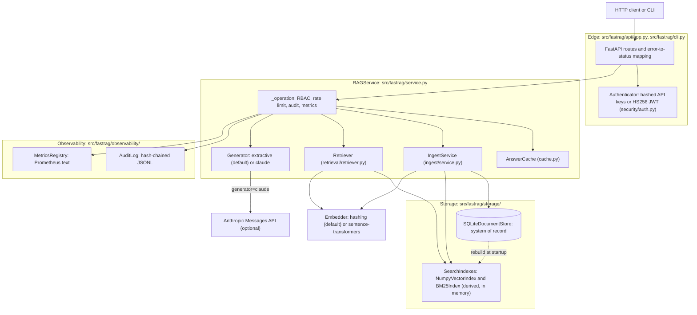
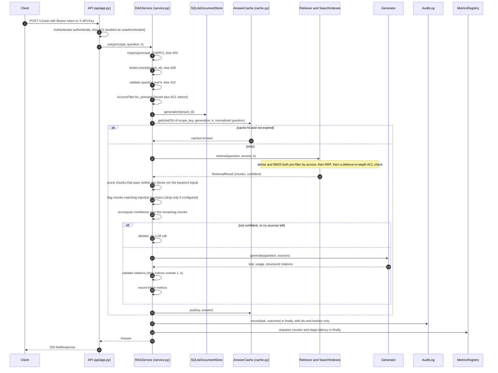
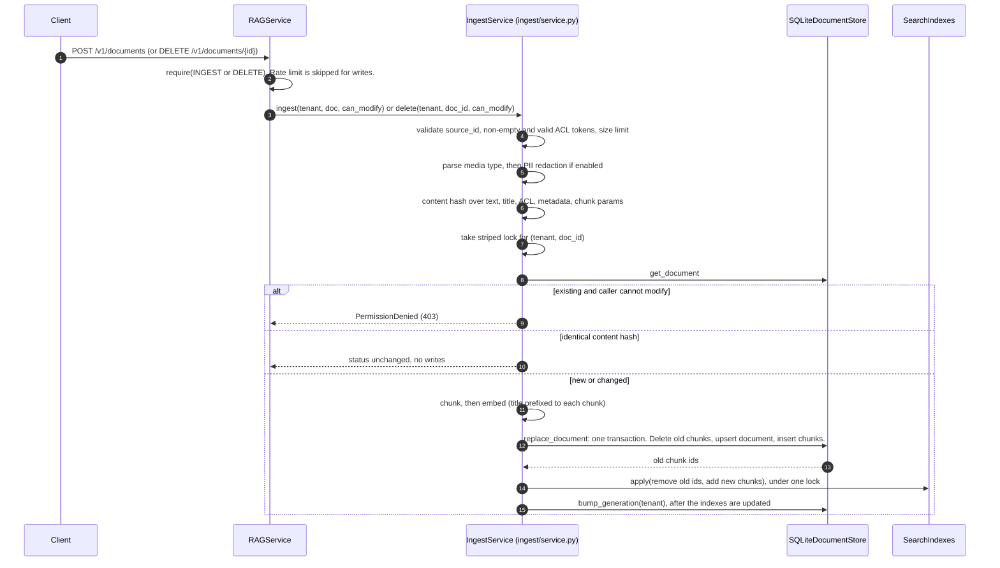

# Architecture

**Last updated:** 2026-11-03
**Entry points:** `src/fastrag/api/app.py` (HTTP), `src/fastrag/cli.py` (operator CLI), `src/fastrag/service.py` (`RAGService`, the only path to data)

> **Code state.** This page describes the code after the pending changes (confidence gate, generation ordering, content-hashed chunk ids, structured citations, API error envelope). Line numbers below are from the pre-change code and will drift. Function and file names are stable.

fastRag is a single-process reference system. Every operation, whether it comes from HTTP, the CLI or the evaluation harness, goes through `RAGService`. That class enforces the same sequence each time: authorize, rate-limit, do the work with an access filter, then audit and count the outcome.

## Component diagram

## Request lifecycle: `POST /v1/ask`

Code order in `RAGService.ask` (`src/fastrag/service.py`, `ask`). The ACL pre-filter runs inside each index search, not as a separate step.

Notes on the order:

- Pruning and injection flagging run **before** the final confidence decision. Confidence is recomputed after suspicious chunks are dropped, so a result that only had flagged evidence abstains instead of generating from nothing.
- The cache key reads the corpus generation **before** retrieval. That is safe now because the generation is bumped only after the indexes are updated (see the next section). A stale answer can only land under an old key.
- Audit and metrics run in the `finally` of `_operation`. They fire on success, denial and error alike. If the audit write fails on an otherwise successful call, the request fails (fail closed).

## Ingest and delete lifecycle

The store is the single source of truth. The indexes are projections of it.

Delete has the same shape. `SQLiteDocumentStore.delete_document` removes the document in one transaction and cascades to its chunks. It then calls `indexes.apply(remove_ids=...)`, and only after that does `IngestService` bump the tenant generation. If the document is absent or not modifiable, the service returns `NotFound`, the same response in both cases.

**Why the order matters.** The generation is part of every cache key. If it were bumped at commit, a query that ran between the commit and the index update could cache an answer built from the old indexes under the new generation, and serve it until the TTL expired. Bumping after the index update closes that window.

**Startup rebuild.** `RAGService.from_settings` opens the store, checks the embedder name, creates empty indexes, then calls `SearchIndexes.rebuild_from(store)` (`service.py:110-119`, `storage/indexes.py:43-52`). Restarting the process is therefore always a full resynchronization.

**Known gap.** Nothing reconciles the indexes with the store while the process runs. `SearchIndexes.consistent_with` exists (`storage/indexes.py:66-70`), but only the tests call it. If `indexes.apply` fails after a commit, the in-memory indexes stay stale until restart.

## Data model

### Persistent (SQLite, `src/fastrag/storage/sqlite.py:22-55`)

| Table | Key | Columns | Notes |
|---|---|---|---|
| `meta` | `key` | `value` | Stores the `embedder` name. A different embedder at startup is a `ConfigurationError` (`sqlite.py:79-88`). |
| `documents` | `(tenant_id, doc_id)` | `source_id`, `title`, `version`, `content_hash`, `acl` (JSON array), `metadata` (JSON), `chunk_count`, `updated_at` | ACL lives here only. Chunks inherit it at load time (`iter_chunks`). |
| `chunks` | `chunk_id` | `tenant_id`, `doc_id`, `version`, `ordinal`, `text`, `embedding` (float32 LE BLOB) | FK to `documents` with `ON DELETE CASCADE`. Index `chunks_by_doc`. Ids include the content hash. |
| `tenant_generation` | `tenant_id` | `generation` | Incremented by `bump_generation` after the indexes are updated, for every document write or delete. Used for cache invalidation. |

Identifiers:

- `doc_id` = first 24 hex chars of `sha256(tenant_id NUL source_id)` (`src/fastrag/domain.py:72-74`). Equal source ids in different tenants never collide.
- `chunk_id` = first 32 hex chars of a SHA-256 over tenant, `doc_id`, version, ordinal **and the content hash** (`src/fastrag/ingest/service.py`). The content hash covers `PIPELINE_VERSION`, the embedder name, the text, the title, the ACL, the metadata and the chunk parameters. A change to any of them produces new chunk ids, so a stale chunk id can never refer to new content.
- `BM25Index` indexes the title together with the text.
- `version` is a counter. Old chunks are deleted in the same transaction (`sqlite.py:150-153`), so there is **no version history** in the store.

### In memory (derived, rebuilt at startup)

- `NumpyVectorIndex` (`src/fastrag/storage/vector.py`): one partition per tenant, holding a float32 matrix and a parallel list of `Chunk`.
- `BM25Index` (`src/fastrag/storage/bm25.py`): one partition per tenant, holding term postings, document lengths and chunks. Term statistics are per tenant.
- `AnswerCache` (`src/fastrag/cache.py`): an `OrderedDict` with TTL and LRU eviction, per process.
- `RateLimiter` buckets (`src/fastrag/ratelimit.py`): per process, keyed by tenant.
- `ApiKeyStore` (`src/fastrag/security/auth.py`): hash-to-principal map, loaded from file at startup.

### Files

| Path (defaults) | Setting | Contents |
|---|---|---|
| `.fastrag/fastrag.db` (+ `-wal`, `-shm`) | `FASTRAG_DATABASE_PATH` | SQLite system of record |
| `.fastrag/api_keys.json` | `FASTRAG_API_KEYS_FILE` | Key hashes and principals, mode 0600 |
| `.fastrag/audit.jsonl` | `FASTRAG_AUDIT_LOG_PATH` | Hash-chained audit entries |

Audit entry shape (`src/fastrag/observability/audit.py:111-122`): `ts`, `request_id`, `action`, `outcome`, `tenant_id`, `user_id`, `details`, `prev_hash`, `hash`.

## Where each enterprise concern lives

| Concern | Module and location |
|---|---|
| Authentication (API keys, JWT) | `security/auth.py` (`Authenticator`, `ApiKeyStore`, `JwtVerifier`), called from `api/app.py:92-106` |
| Action authorization (RBAC) | `security/rbac.py` (`require`), called from `service.py:278` |
| Document ACLs and tokens | `domain.py` (`EVERYONE`, `Principal.acl_tokens`), `security/acl.py` (`AccessFilter.allows`) |
| Tenant isolation | `storage/vector.py:58`, `storage/bm25.py:82` (per-tenant partitions), `domain.py:72-74`, `storage/sqlite.py` PK `(tenant_id, doc_id)` |
| ACL enforcement at query time | `storage/vector.py:61-65`, `storage/bm25.py:100` (pre-filter), `retrieval/retriever.py:57-61` (post-check) |
| Rate limiting | `ratelimit.py`, `service.py:279-280` (queries only) |
| Answer caching | `cache.py` (key includes scope and generation), `service.py:197-205`, `:246` |
| PII redaction | `ingest/redact.py`, `ingest/service.py:84-87` |
| Prompt-injection defense | `generation/prompt.py`, `service.py:209-214` |
| Citation validation | `generation/citations.py`, `service.py` (structured citations from the generator) |
| Confidence gate and abstention | `retrieval/retriever.py` (pruning and gate), `service.py` (recompute after drop, abstain) |
| Audit trail | `observability/audit.py`, `service.py:305-310` |
| Metrics | `observability/metrics.py`, `service.py:306-308` and call sites |
| Structured logs and request ids | `observability/logging.py`, `api/app.py:63-74` |
| Error-to-HTTP mapping | `errors.py`, `api/app.py:45-90` |
| Config validation | `config.py` (`Settings`, `_check`) |
| Embedder pinning | `storage/sqlite.py:79-88` |
| Index rebuild on startup | `service.py:118-119`, `storage/indexes.py:43-52` |
| Secure delete of content | `storage/sqlite.py:70` (file databases only) |
| Credential file permissions | `security/auth.py:101-105` |

## Extension points and what is not implemented

These are documented as extension points. None of them is implemented in the code.

| Capability | Status |
|---|---|
| OIDC or JWKS verification (RS256 or ES256) | Not implemented. `security/auth.py:8-10` describes the swap. Only HS256 with a shared secret is verified. |
| pgvector or Postgres storage | Not implemented. Interfaces are in `storage/base.py`, and the SQLite schema maps to Postgres. |
| Postgres row-level security | Not implemented. See ADR 0002. |
| Reranker or MMR diversification | Not implemented. |
| Async ingestion queue | Not implemented. Ingest runs inline in the request. |
| Streaming responses | Not implemented. |
| Redis-backed rate limiting or cache | Not implemented. `ratelimit.py:3-5` describes the swap. |
| OpenTelemetry tracing | Not implemented. Correlation uses `request_id` only. |
| Multi-replica deployment | Not supported. Each process holds its own indexes and cache. See `docs/operations.md`. |
| `fastrag eval` regression gate | Present. `src/fastrag/eval/` runs the golden set in `eval/golden/` and exits 0 (pass), 1 (gate failure) or 2 (error). It is a regression gate, not a quality claim. See ADR 0006. |

Related docs: [security.md](security.md), [operations.md](operations.md), [adr/0001-single-source-of-truth.md](adr/0001-single-source-of-truth.md).
