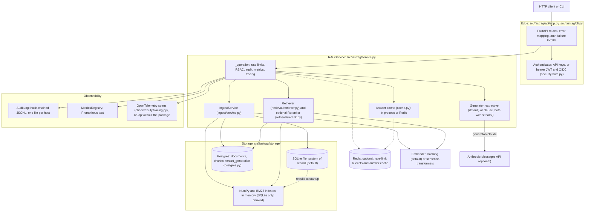
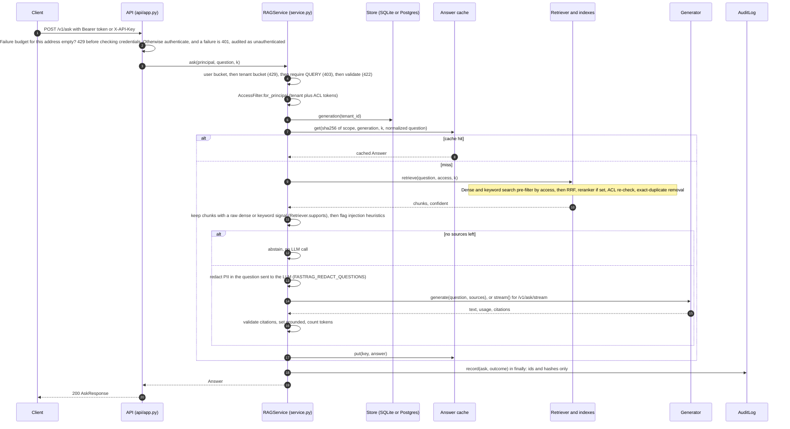
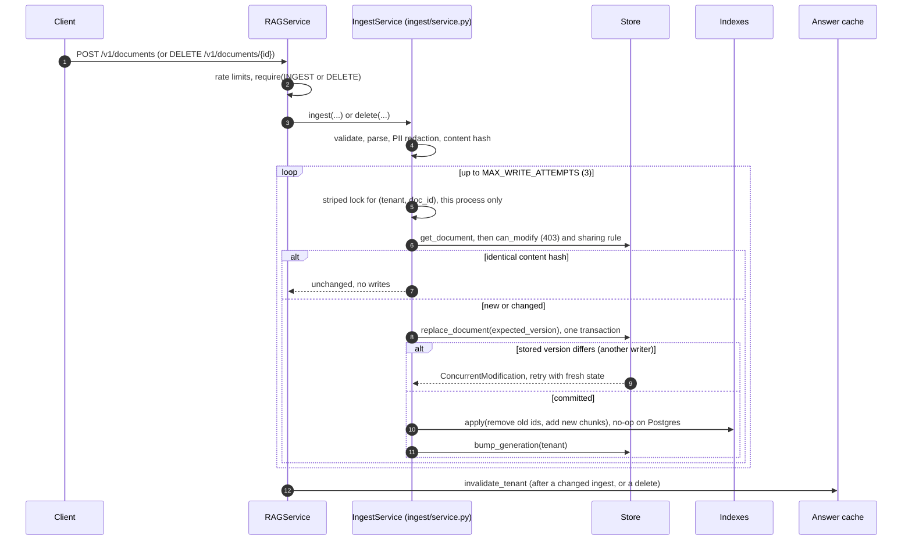

# Architecture

**Last updated:** 2026-11-03
**Entry points:** `src/fastrag/api/app.py` (HTTP), `src/fastrag/cli.py` (operator CLI), `src/fastrag/service.py` (`RAGService`, the only path to data)

Every operation, whether it comes from HTTP, the CLI or the evaluation harness, goes through `RAGService`. Each call follows the same sequence in `RAGService._operation`: rate limit (user bucket, then tenant bucket), authorize (RBAC), do the work with an access filter, then audit, count and trace the outcome in a `finally` block. This page names modules and functions, not line numbers.

There are two deployment shapes, and the same code runs both:

- **SQLite (default).** One file is the system of record, and each process keeps its own in-memory indexes. One process per host.
- **Postgres with pgvector (`FASTRAG_POSTGRES_DSN`).** The tables are the system of record and the search indexes, so several replicas see the same data. Redis (`FASTRAG_REDIS_URL`) optionally shares rate limits and the answer cache. See [adr/0007-postgres-storage.md](adr/0007-postgres-storage.md).

## Component diagram

## Request lifecycle: `POST /v1/ask`

`POST /v1/ask/stream` runs the same steps through `RAGService.ask_stream`. The ACL pre-filter runs inside each index search, not as a separate step.

Notes on the order and the streaming path:

- Pruning and injection flagging run **before** the abstain decision. A result whose only evidence was flagged (with dropping enabled) abstains instead of generating from nothing.
- The cache key reads the corpus generation **before** retrieval, so a stale answer can only land under an old key.
- **Streaming.** `ask_stream` yields `delta` events (raw model text, not yet validated), then one `answer` event with the validated text and citations. The endpoint runs to the first event before it responds, so errors before the stream starts are ordinary HTTP errors. Later failures become in-band `error` events, and an abandoned stream is audited as `cancelled`.
- Audit and metrics run in the `finally` of `_operation`. They fire on success, denial and error alike. If the audit write fails on an otherwise successful call, the request fails (fail closed).
- `Answer.grounded` is false when a non-abstained answer cites nothing. It is counted in `fastrag_ungrounded_answers_total` (generated answers only, not cache hits) and audited as `ungrounded: true`. The audit outcome stays `success`.

## Ingest and delete lifecycle

The store is the system of record. The indexes are projections of it.

Delete follows the same shape: `delete_document(expected_version)`, then `indexes.apply(remove_ids=...)`, then `bump_generation`. An absent or non-modifiable document gives the same `NotFound`.

- **Order matters.** The generation is part of every cache key. Bumping it only after the indexes are updated means a query cannot cache an answer built from the old indexes under the new generation. On Postgres the rows are the index, so the bump follows the commit.
- **Concurrency.** `replace_document` and `delete_document` take the expected version, and the store raises `ConcurrentModification` on a mismatch (HTTP 409 once retries run out). Postgres also holds a transaction-scoped advisory lock per document, so writers on different replicas serialize. `MAX_WRITE_ATTEMPTS` is 3, and each retry re-checks permissions.
- **Cache purge.** After a changed ingest or a delete, `invalidate_tenant` removes that tenant's cached answers from this process (or from Redis) at once. The generation keys are the second guard.
- **Startup.** SQLite: `RAGService.from_settings` creates empty indexes and calls `SearchIndexes.rebuild_from(store)`, so a restart is a full resynchronization. Postgres: no rebuild. Migrations run when the store is constructed, unless `FASTRAG_POSTGRES_MIGRATE_ON_START=false`, in which case the schema is only checked and `fastrag db migrate` applies migrations.

**Known gap (SQLite only).** Other processes on the same file do not see a change until they restart. A delete is therefore still served by a second process, and its answers can be cached under the new generation. Use Postgres for more than one process. If `indexes.apply` fails after a commit, the indexes stay stale until restart.

## Data model

### Persistent: SQLite (`src/fastrag/storage/sqlite.py`)

| Table | Key | Columns | Notes |
|---|---|---|---|
| `meta` | `key` | `value` | `embedder` (a different embedder at startup is a `ConfigurationError`) and `schema_version` (2). |
| `documents` | `(tenant_id, doc_id)` | `source_id`, `title`, `version`, `content_hash`, `acl` (JSON array), `editors` (JSON array), `metadata` (JSON), `chunk_count`, `updated_at` | ACL lives here only. Chunks inherit it at load time (`iter_chunks`). |
| `chunks` | `chunk_id` | `tenant_id`, `doc_id`, `version`, `ordinal`, `text`, `embedding` (float32 LE BLOB) | FK to `documents` with `ON DELETE CASCADE`. Index `chunks_by_doc`. |
| `tenant_generation` | `tenant_id` | `generation` | Bumped after the indexes are updated. Used for cache keys. |

`SQLiteDocumentStore._migrate` upgrades a version 1 database in place. Migrated documents have empty `editors`, so only admins can change them.

### Persistent: Postgres (`src/fastrag/storage/postgres.py`)

Tables `documents` (`acl` and `editors` as `text[]`, `metadata` as `jsonb`), `chunks` (denormalized `acl`, plus `embedding vector(dim)` and `tsv`, with a foreign key to `documents`), `tenant_generation`, and `meta` (`schema_version`, `embedder`, `embedding_dim`). Indexes: btree on `(tenant_id, doc_id)`, GIN on `acl` and `tsv`, HNSW on `embedding` (skipped above 2000 dimensions). Details are in ADR 0007.

### Identifiers

- `doc_id` = first 24 hex chars of `sha256(tenant_id NUL source_id)` (`domain.document_id`). Equal source ids in different tenants never collide.
- `chunk_id` = first 32 hex chars of a SHA-256 over tenant, `doc_id`, version, ordinal **and the content hash** (`IngestService.ingest`). The content hash covers `PIPELINE_VERSION`, the embedder name, text, title, ACL, editors, metadata and chunk parameters, so a stale chunk id never refers to new content.
- `version` is a counter. Old chunks are deleted in the same transaction, so there is **no version history**.

### What is per process

| Component | SQLite deployment | Postgres (+ Redis) deployment |
|---|---|---|
| Documents, chunks and search indexes | File plus in-memory NumPy and BM25 (`storage/vector.py`, `storage/bm25.py`) in each process. Other processes miss writes until restart. | The tables. Every replica queries the same rows. |
| Answer cache (`cache.py`) | Per process (`AnswerCache`). | Per process unless Redis (`RedisAnswerCache`). Without Redis, other replicas' entries for a deleted document stay in memory until TTL or restart; generation keys keep them unreachable. |
| Rate limits and auth-failure throttle (`ratelimit.py`) | Per process. | Per process unless Redis (`RedisRateLimiter`). N replicas allow N times the configured rate. |
| API keys (`security/auth.py`) | Keys file, re-read on change. | Each replica needs the keys file (shared storage or distributed). |
| Reranker model | Loaded in each process at startup. | Same. |
| Audit log (`observability/audit.py`) | One JSONL file per host. | Still one file per host: the audit chain is not in Postgres. |

### Files

| Path (defaults) | Setting | Contents |
|---|---|---|
| `.fastrag/fastrag.db` (+ `-wal`, `-shm`) | `FASTRAG_DATABASE_PATH` | SQLite system of record, mode 0600. Not used when `FASTRAG_POSTGRES_DSN` is set. |
| `.fastrag/api_keys.json` (+ `.lock`, `.tmp`) | `FASTRAG_API_KEYS_FILE` | Key hashes, ids, expiry and revocation, mode 0600. The writer lock and temporary file sit beside it. |
| `.fastrag/audit.jsonl` | `FASTRAG_AUDIT_LOG_PATH` | Hash-chained audit entries, mode 0600. |

Audit entry shape (`observability/audit.py`, `AuditLog.record`): `ts`, `request_id`, `action`, `outcome`, `tenant_id`, `user_id`, `details`, `prev_hash`, `hash`.

## Where each enterprise concern lives

| Concern | Module and function |
|---|---|
| Authentication (API keys, bearer tokens) | `security/auth.py` (`Authenticator.authenticate`, `ApiKeyStore`, `JwtVerifier`, `OidcVerifier`), called from `api/app.py` (`current_principal`) |
| Token claim mapping and lifetime | `security/auth.py` (`ClaimMapping`, `_principal_from_claims`, `_check_lifetime`) |
| Auth-failure throttle | `api/app.py` (`current_principal`), `ratelimit.py` (in process or Redis) |
| Action authorization (RBAC) | `security/rbac.py` (`require`), called from `service.py` (`_operation`) |
| Write authorization and sharing rule | `service.py` (`_can_modify`), `ingest/service.py` (`ingest`, `can_change_sharing`) |
| Optimistic concurrency | `storage/base.py` (`UNCHECKED`), `errors.py` (`ConcurrentModification`), `storage/sqlite.py` and `storage/postgres.py` (`_check_version`), `ingest/service.py` (`MAX_WRITE_ATTEMPTS`) |
| Document ACLs and tokens | `domain.py` (`EVERYONE`, `Principal.acl_tokens`), `security/acl.py` (`AccessFilter.allows`) |
| Tenant isolation | Per-tenant partitions in `storage/vector.py` and `storage/bm25.py`; `WHERE tenant_id` in `storage/postgres.py`; `domain.py` (`document_id`) |
| ACL enforcement at query time | Pre-filter in `storage/vector.py`, `storage/bm25.py`, and the SQL `WHERE` in `storage/postgres.py`; post-check in `retrieval/retriever.py` |
| Rate limiting | `ratelimit.py` (`RateLimiter`, `RedisRateLimiter`), `service.py` (`_operation`) |
| Answer caching and purge | `cache.py` (`cache_key`, `AnswerCache`, `RedisAnswerCache`), `service.py` (`ask`, `ingest`, `delete`) |
| Hybrid retrieval and reranking | `retrieval/retriever.py` (`retrieve`, `supports`), `retrieval/rerank.py` (`CrossEncoderReranker`, `get_reranker`) |
| Streaming | `service.py` (`ask_stream`, `AskEvent`), `api/app.py` (`ask_stream`, `_EventStream`), `generation/claude.py` (`stream`) |
| PII redaction | `ingest/redact.py` (`Redactor`); `ingest/service.py` (ingest); `service.py` (`_outbound_question`, questions) |
| Prompt-injection defense | `generation/prompt.py`, `service.py` (`ask`) |
| Citation validation and grounding | `generation/citations.py`, `service.py` (`_grounded_answer`), `domain.py` (`Answer.grounded`) |
| Confidence gate and abstention | `retrieval/retriever.py` (`supports`), `service.py` (`_ask`) |
| Audit trail | `observability/audit.py` (`JsonlAuditSink`, `AuditLog`), `service.py` (`_operation`) |
| Metrics, tracing, logs and request ids | `observability/metrics.py`, `observability/tracing.py` (`start_span`, `end_span`), `observability/logging.py`, `api/app.py` (`request_context`) |
| Error-to-HTTP mapping | `errors.py`, `api/app.py` (`domain_error`, `_STATUS`) |
| Config validation and production mode | `config.py` (`Settings._check`, `Settings._check_production`) |
| Embedder pinning | `storage/sqlite.py` and `storage/postgres.py` (`check_embedder`) |
| Index rebuild on startup (SQLite) | `service.py` (`from_settings`), `storage/indexes.py` (`rebuild_from`) |

## Extension points and status

| Capability | Status |
|---|---|
| OIDC or JWKS verification (RS256, ES256, PS256) | Implemented: `OidcVerifier`, enabled by `FASTRAG_OIDC_JWKS_URL`. HS256 remains for service tokens and demos. |
| Postgres + pgvector storage and indexes | Implemented, opt-in (`FASTRAG_POSTGRES_DSN`). The integration suite has not yet passed end to end. See ADR 0007. |
| Postgres row-level security | Not enabled. Described in `docs/operations.md`. |
| Redis rate limits and answer cache | Implemented, opt-in (`FASTRAG_REDIS_URL`). |
| Reranker | Implemented, opt-in: `CrossEncoderReranker` (`FASTRAG_RERANKER`). Off by default. |
| Streaming responses | Implemented: `POST /v1/ask/stream`. |
| OpenTelemetry spans | Implemented, opt-in with `fastrag[otel]` and an SDK configured by the deployment. No `FASTRAG_` setting. |
| MMR diversification | Not implemented. Exact-duplicate removal is implemented (`Retriever.retrieve`). |
| Token revocation before `exp` | Not implemented. Lifetimes are capped at 24 hours. |
| Async ingestion queue | Not implemented. Ingest runs inline in the request. |
| Multi-replica deployment | Supported with Postgres and Redis (see `docs/operations.md`). SQLite is single-process. |
| `fastrag eval` regression gate | Present. Runs the golden set in `eval/golden/`, exit 0 pass, 1 gate failure, 2 error. A regression gate, not a quality claim (ADR 0006). |

Related docs: [security.md](security.md), [operations.md](operations.md), [adr/0001-single-source-of-truth.md](adr/0001-single-source-of-truth.md), [adr/0007-postgres-storage.md](adr/0007-postgres-storage.md).
